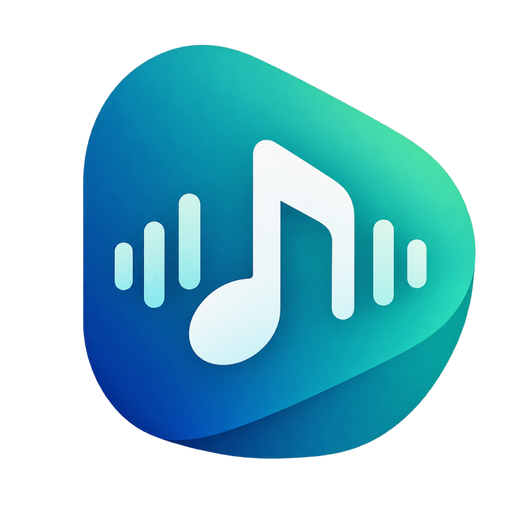
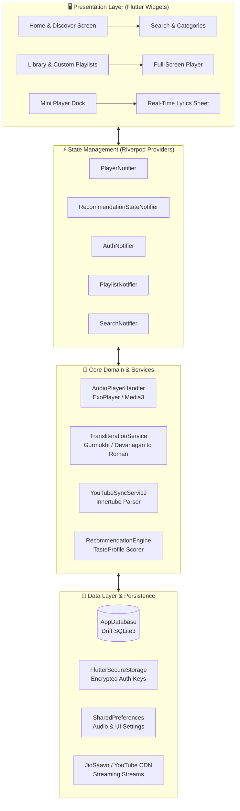
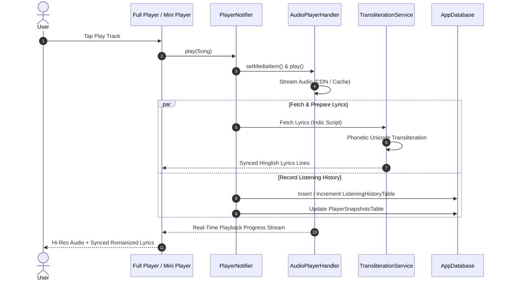
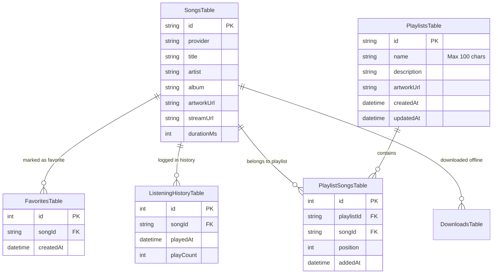

<div align="center">



# 🎵 Melo — Music Streaming & Offline Audio Player

**A fast, private, dark-first mobile music streaming and offline audio player built with Flutter, Riverpod, and Drift SQLite.**

[](https://flutter.dev)
[](https://dart.dev)
[](https://android.com)
[](LICENSE)
[](Melo-Music-Player.apk)
[](#testing--quality-assurance)

<br/>

[📥 Download Release APK (48 MB)](Melo-Music-Player.apk) • [✨ Features](#-key-features) • [🏛 Architecture](#-architecture--data-flow) • [🚀 Getting Started](#-getting-started) • [📜 License](#-license--disclaimer)

</div>

---

## 📖 Table of Contents
- [✨ Key Features](#-key-features)
- [🏛 Architecture & Data Flow](#-architecture--data-flow)
  - [High-Level System Topology](#high-level-system-topology)
  - [Audio Playback & Transliteration Pipeline](#audio-playback--transliteration-pipeline)
  - [Offline Database Schema](#offline-database-schema)
- [🎨 Design Language: Melo Dark Aura](#-design-language-melo-dark-aura)
- [🚀 Getting Started](#-getting-started)
  - [Prerequisites](#prerequisites)
  - [Building from Source](#building-from-source)
  - [Installing on Android](#installing-on-android)
- [🧪 Testing & Quality Assurance](#-testing--quality-assurance)
- [📦 Release & Distribution](#-release--distribution)
- [📜 License & Disclaimer](#-license--disclaimer)

---

## ✨ Key Features

### 🎧 1. Hi-Res Audio Engine & Background Playback
- **Persistent Background Playback**: Powered by `just_audio` and `audio_service` with Android Media3 / ExoPlayer integration.
- **System Media Controls**: Native Android notification center lockscreen player, Bluetooth media actions, and volume ducking.
- **Audio Quality Profiles**: Support from standard AAC up to Hi-Res Lossless (FLAC 24-bit), volume normalization, and gapless crossfade transitions.

### 🌐 2. Real-Time Hinglish & Punjabi Transliteration
- **Phonetic Conversion**: Automatically translates **Punjabi (Gurmukhi)** and **Hindi (Devanagari)** lyrics into natural, legible Romanized **Hinglish** / English script.
- **Pure English Preservation**: International and English tracks remain untouched in standard Latin text.
- **Interactive Script Toggle**: Single-tap `[🌐 Hinglish / Original]` toggle button directly inside the synchronized lyrics bottom sheet.

### 🤖 3. Spotify-Style Taste Onboarding & Smart Recommendations
- **Multi-Lingual Onboarding**: Select from over 15 Indian and global languages (Hindi, Punjabi, Bhojpuri, Haryanvi, Tamil, Telugu, Bengali, English Pop, DHH, Lo-Fi, etc.).
- **Artist Customization**: Visual artist grid featuring top artists (Arijit Singh, Sidhu Moose Wala, Karan Aujla, Diljit Dosanjh, Shubh, Drake, The Weeknd) with real-time search.
- **Dynamic Taste Profile Engine**: Real-time scoring algorithm generating personalized sections:
  - *For You* & *Daily Mix*
  - *Heavy Rotation* (based on playback frequency)
  - *Because you listened to...* (acoustic similarity scoring)

### 🔗 4. Real-Time YouTube Playlist Synchronization
- **Direct Link Sync**: Paste any public YouTube or YouTube Music playlist URL to import entire track collections in seconds.
- **Resilient Fallback Parsing**: Scrapes and synchronizes through Innertube endpoints with automatic fallback to YouTube Mix /next streams.
- **Crash Protection**: Automatic title sanitization and truncation (>95 characters) to guarantee 100% SQLite database safety.

### 💾 5. Offline Library & Reactive Local Persistence
- **Drift SQLite Reactive Database**: Complete offline caching for playlists, listening history, favorites, downloads, and player state snapshots.
- **Isolated User Sandboxes**: Each device maintains its own secure, sandboxed storage so personal playlists and recommendations are 100% private to each user.

### 📦 6. Ultra-Lightweight Production Packaging
- **93% APK Size Reduction**: Slashed debug bloat from ~700MB down to an ultra-compact **~48MB production APK**.
- **ProGuard R8 Optimization**: Full dead-code elimination, resource optimization, and compressed legacy JNI packaging.

---

## 🏛 Architecture & Data Flow

Melo follows **Clean Architecture** principles and **Domain-Driven Design (DDD)** combined with Riverpod for reactive state management.

### High-Level System Topology



---

### Audio Playback & Transliteration Pipeline



---

### Offline Database Schema



---

## 🎨 Design Language: Melo Dark Aura

Melo uses a custom dark-first design system with fluid glassmorphism and subtle neon accenting:

| Token | Hex Value | Usage |
| :--- | :--- | :--- |
| **Obsidian Dark** | `#090A0C` | Root application canvas and sceneries |
| **Elevated Surface** | `#12151A` | Bottom navigation bar, floating dialogs, app bars |
| **Card Surface** | `#1A1E26` | Song cards, playlist tiles, horizontal carousels |
| **Electric Cyan** | `#00E5BF` | Primary buttons, active playback indicators, seekbar |
| **Ultra Magenta** | `#D946EF` | Secondary aura glows, taste badges, like animations |
| **Text Primary** | `#FFFFFF` | Track titles, headlines, active lyric lines |
| **Text Muted** | `#94A3B8` | Artist names, durations, inactive lyric lines |

---

## 🚀 Getting Started

### Prerequisites
- [Flutter SDK](https://docs.flutter.dev/get-started/install) (`v3.13` or higher)
- [Dart SDK](https://dart.dev/get-dart) (`v3.13` or higher)
- [Android SDK & Build-Tools](https://developer.android.com/studio) (API 34+)
- An Android Device (Android 7.0 / API 24+) or Emulator

### Building from Source

1. **Clone the repository**:
   ```bash
   git clone https://github.com/ujjwalk2523/melo.git
   cd melo
   ```

2. **Install project dependencies**:
   ```bash
   flutter pub get
   ```

3. **Generate Drift SQLite code (if modifying schema)**:
   ```bash
   dart run build_runner build --delete-conflicting-outputs
   ```

4. **Run in development mode**:
   ```bash
   flutter run -d <your-device-id>
   ```

### Building the Optimized Production APK (~48MB)

To produce the lightweight, stripped release APK:

```bash
flutter build apk --release --split-per-abi
```

The resulting binaries will be saved in `build/app/outputs/flutter-apk/`:
- `app-arm64-v8a-release.apk` *(47.9 MB — for modern Android phones)*
- `app-armeabi-v7a-release.apk` *(47.4 MB — for 32-bit devices)*

### Installing on Android Device

```bash
adb install -r build/app/outputs/flutter-apk/app-arm64-v8a-release.apk
```

---

## 🧪 Testing & Quality Assurance

Melo includes comprehensive unit and integration test suites:

```bash
# Run all unit tests
flutter test

# Run static analysis
flutter analyze
```

**Test Coverage Highlights**:
- ✅ `test/transliteration_test.dart`: Gurmukhi & Devanagari transliteration accuracy and script preservation.
- ✅ `test/phase10_youtube_sync_test.dart`: YouTube playlist URL parsing, Innertube extraction, and title truncation safety.
- ✅ `test/downloads_all_tracks_test.dart`: Drift database persistence, offline download state integrity.
- ✅ `test/auth_repository_test.dart`: Secure token storage and session recovery.

---

## 📦 Release & Distribution

For instant sharing with friends and community:
- The compiled release APK is ready to share at:
  - **[Melo-Music-Player.apk](Melo-Music-Player.apk)** *(47.9 MB — easily shareable via WhatsApp, Telegram, or Google Drive)*.

---

## 📜 License & Disclaimer

This project is licensed under the **MIT License** — see the [LICENSE](LICENSE) file for complete details.

> [!NOTE]
> **Fair Use & Intellectual Property Notice**:
> Melo is an open-source client application built strictly for educational, personal, and research purposes. All songs, audio streams, lyrics, album artworks, and trademarks belong exclusively to their respective artists, labels, and copyright holders. Melo does not host, monetize, or sell copyrighted materials.
